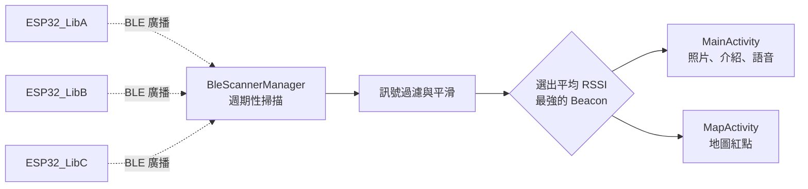

# NTHU Library Tour：BLE Beacon 室內定位語音導覽 App

> 走到哪、導覽到哪 —— 一款以 ESP32 BLE Beacon 進行室內區域定位的 Android 圖書館導覽 App。靠近導覽點時自動顯示該區域的介紹與照片，提供中英雙語語音導覽，並在館內平面圖上標示目前位置。
> 2025 Wireless Network Final Project


---

## Demo 影片

[](https://youtu.be/qTO1KGZuR1I)

點擊圖片或前往 YouTube 觀看：<https://youtu.be/qTO1KGZuR1I>

## 專案簡介

GPS 在室內幾乎無法使用，傳統的圖書館導覽多半仰賴紙本地圖或固定的解說牌。本專案在清華大學圖書館 1 樓的3處導覽點放置 ESP32 作為 BLE Beacon，App 持續掃描周圍的 Beacon 訊號，依訊號強度（RSSI）判斷使用者目前最接近哪一個區域，並自動切換成該區域的導覽內容。

使用者不需要掃描 QR Code 或手動選擇地點，只要帶著手機在館內走動，就能隨時收聽目前所在區域的介紹。

## 主要功能

- **自動區域偵測**：靠近導覽點時，App 自動切換顯示該區域的名稱與照片，離開所有導覽點後則回到歡迎畫面。
- **中英雙語語音導覽**：每個區域都提供中文與英文兩種語音解說；切換區域時會自動停止上一段語音，避免內容錯置。
- **館內地圖定位**：在 1 樓平面圖上以紅點標示目前所在區域的估計位置，並隨區域變化即時移動。
- **省電掃描策略**：以「掃描 8 秒、休息 4 秒」的週期進行 BLE 掃描，App 進入背景時暫停監聽與語音播放。

## 導覽區域

| Beacon 名稱 | 區域 | 說明 |
| --- | --- | --- |
| `ESP32_LibA` | 知識集（The Circle） | 新知、主題展區 |
| `ESP32_LibB` | 清沙龍（Idea Hub） | 討論與交流空間 |
| `ESP32_LibC` | 輕學區（Light Up Zone） | 輕鬆學習區 |

## 定位原理



App 不是單純取「當下訊號最強」的 Beacon，而是做了幾層處理，讓區域判斷更穩定、不會在兩區之間來回跳動：

1. **訊號門檻**：RSSI 低於 −80 dBm 的 Beacon 視為距離太遠，不納入判斷。
2. **移動平均**：每個 Beacon 保留最近 5 筆 RSSI，以平均值降低訊號瞬間波動的影響。
3. **過期淘汰**：超過 6 秒沒有再收到訊號的 Beacon 會被排除，確保離開後能正確更新位置。
4. **觀察者模式**：`BleScannerManager` 以單例管理掃描，區域改變時通知所有註冊的畫面（`AreaChangeListener`），導覽頁與地圖頁共用同一份定位結果。

## 專案結構

```
LibraryTour/app/src/main/
├── java/com/techmania/librarytour/
│   ├── WelcomeActivity.kt      # 歡迎頁
│   ├── MainActivity.kt         # 導覽主頁：區域資訊、中英語音播放、權限處理
│   ├── MapActivity.kt          # 館內地圖：以紅點標示目前區域
│   └── BleScannerManager.kt    # BLE 掃描、RSSI 平滑與區域判斷（單例）
└── res/
    ├── drawable/               # 區域照片、1F 平面圖、背景圖
    ├── layout/                 # 三個頁面的版面配置
    └── raw/                    # 中英文導覽語音（mp3）
```

## 快速開始

### 環境需求

- Android Studio（建議使用最新穩定版）
- 支援 BLE 的 Android 實體手機，Android 8.0（API 26）以上
- 3 片 ESP32 開發板作為 Beacon

### 1. 準備 Beacon

將 3 片 ESP32 設定為 BLE 廣播裝置，裝置名稱分別設為 `ESP32_LibA`、`ESP32_LibB`、`ESP32_LibC`，並放置於各導覽點。App 以**裝置名稱**辨識 Beacon，名稱必須完全一致。

### 2. 建置並安裝 App

```bash
git clone https://github.com/penny11124/Library-Tour.git
```

1. 以 Android Studio 開啟 `LibraryTour` 資料夾，等待 Gradle 同步完成。
2. 手機開啟開發者模式與 USB 偵錯後連接電腦，按下 Run 安裝。
3. 首次開啟時允許藍牙（Android 12 以上）或位置（Android 11 以下）權限，並確認手機藍牙已開啟。

> 模擬器不支援 BLE 掃描，請使用實體手機測試。

## 🔧 自訂導覽內容

若要將 App 用在其他場館或新增導覽點，需要修改以下幾處：

- `BleScannerManager.kt`：新增 Beacon 名稱，並在 `evaluateCurrentArea()` 對應到區域代號；也可調整 `MIN_RSSI_THRESHOLD` 以配合場地大小。
- `MainActivity.kt`：在 `updateGuideContent()` 與 `getAudioResourceForArea()` 設定該區域的介紹文字、照片與語音檔。
- `MapActivity.kt`：在 `zonePositions` 以 0–1 的比例座標設定區域在平面圖上的位置。
- `res/drawable`、`res/raw`：放入對應的照片、平面圖與語音檔。

## 🛠️ 技術棧

- **App**：Kotlin、Android SDK（compileSdk 34 / minSdk 26）、AndroidX、Material Components
- **定位**：Android BLE API（`BluetoothLeScanner`）、RSSI 移動平均
- **Beacon**：ESP32 BLE 廣播
- **多媒體**：MediaPlayer 播放中英文語音
